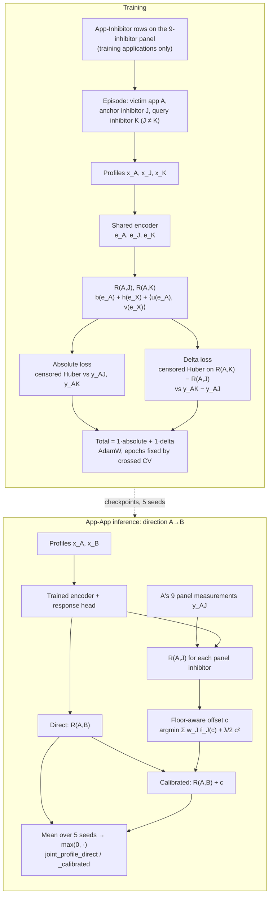
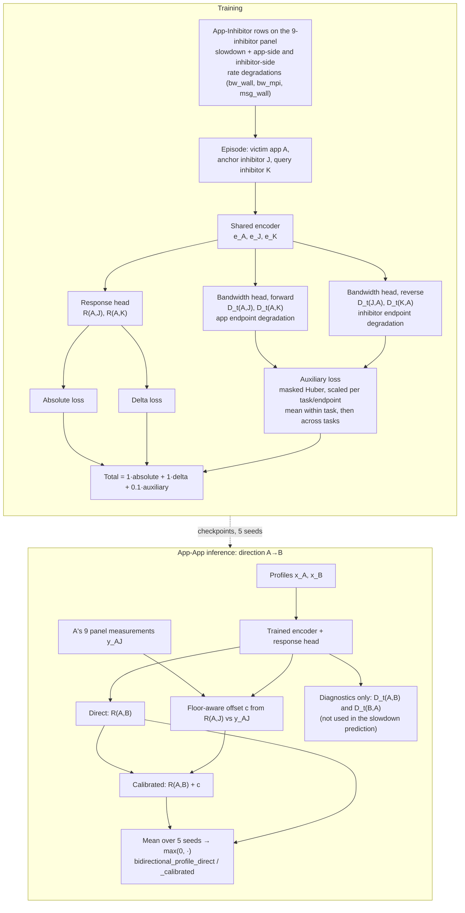
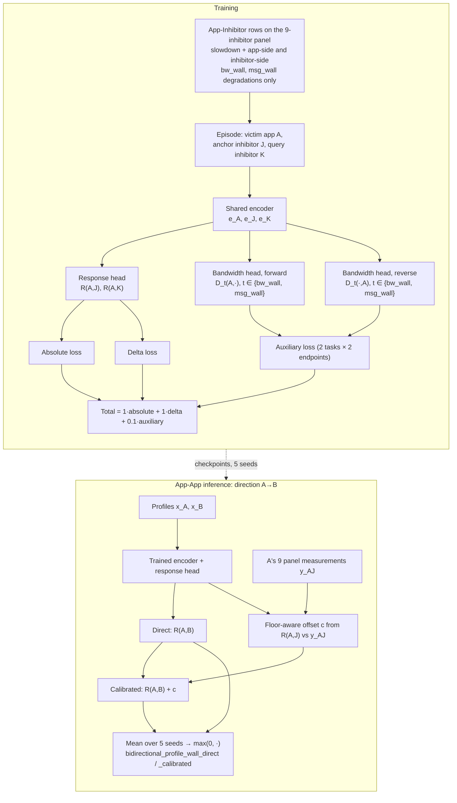
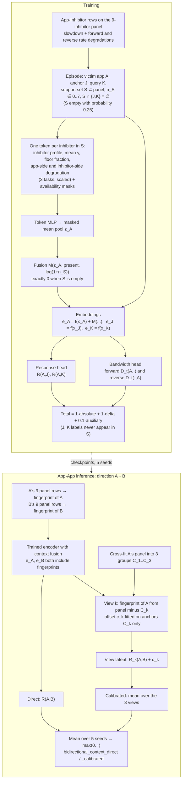
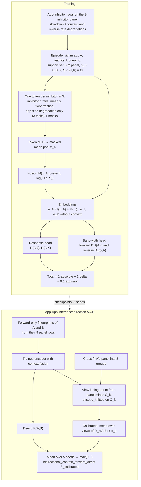

# Bidirectional Variant Diagrams

One diagram per joint-family variant in `pipeline.py:VARIANT_REGISTRY`, showing
how each is trained and how it produces an App-App prediction. The `legacy_*`
variants are documented in `schematic.md` Part B.

## Shared notation and steps

| Symbol | Meaning |
|---|---|
| `x_V` | 4 standardized isolated-profile features: `comm_frac`, `log1p` message rate, `log1p` byte rate, `log1p` mean message size (fold-local scaler) |
| `e_V = f(x_V)` | shared encoder embedding (same network for applications and inhibitors) |
| `R(V, X)` | latent log slowdown of victim `V` under aggressor `X`: `b(e_V) + h(e_X) + <u(e_V), v(e_X)>` |
| `y` | observed log slowdown, `log(max(1, T_MPI_co / T_MPI_iso))`; `y = 0` is the floor (censored) |
| `D_t(V, X)` | bandwidth head, `g([e_V, e_X, u, v, u*v])`, predicting the rate degradation of endpoint `V` for task `t` |
| panel | the 9 selected inhibitors; every training and calibration label comes from App-Inhibitor runs on this panel |

Steps every variant shares:

- **Episodes.** Pick a training application `A` uniformly, then two distinct
  panel inhibitors: `J` (anchor) and `K` (query). For each one, draw one replicate
  row. A batch holds 128 episodes, and an epoch is 4 batches.
- **Response losses.** The censored absolute Huber loss on `R(A,J)` and `R(A,K)`:
  floor rows are penalized only if the prediction is above 0. The identified
  censored delta Huber loss on `R(A,K) - R(A,J)`: a pair where both rows are at
  the floor adds nothing. Each has weight 1.
- **Training schedule.** Crossed validation (hold out one application × one
  inhibitor block, 5 seeds) picks the number of epochs (median best epoch) and
  the calibration `λ ∈ {0.1, 1, 10}`. The final models are then trained on all
  training applications with 5 seeds, AdamW, lr 1e-3, weight decay 1e-4.
- **Output.** App-App directions `A→B` and `B→A` are evaluated separately,
  with the same response function. Latent predictions are averaged over seeds,
  then clipped at the floor: `ŷ = max(0, mean latent)`.
- **Calibration (`_calibrated` methods).** Fit one offset `c` per victim:
  `argmin_c Σ_J w_J ℓ_J(c) + λ/2 c²`, where `ℓ_J` is `Huber(R(A,J)+c − y_AJ)`
  for exact anchors and `Huber(max(0, R(A,J)+c))` for floor anchors, and
  `w_J` gives each inhibitor equal weight. Then predict `R(A,B) + c`.

Selected settings in `outputs/full_comparison` are listed under each diagram.

---

## 1. `joint_profile`

Absolute + delta response model with a victim-level term. It has no auxiliary
tasks and no fingerprints.

Selected: 1 epoch, `λ = 1`.

---

## 2. `bidirectional_profile`

`joint_profile` plus a bandwidth head trained on both endpoints of every
App-Inhibitor run: how much the application's rates degrade (forward), and how
much the inhibitor's rates degrade (reverse).

Selected: 2 epochs, `λ = 1`. The reverse supervision affects the slowdown
prediction only through the shared encoder and the `u`, `v` heads.

---

## 3. `bidirectional_profile_wall` (ablation)

Same as `bidirectional_profile`, but the auxiliary tasks are only the
wall-clock-normalized rates (`bw_wall`, `msg_wall`). MPI-time throughput
(`bw_mpi`) is dropped because it shares a denominator with the slowdown target.

Selected: 2 epochs, `λ = 1`.

---

## 4. `bidirectional_context`

`bidirectional_profile` plus a fingerprint: the application's embedding is
adjusted by a permutation-invariant summary of its own measured panel
responses. Inhibitors never get a fingerprint.

Selected: 2 epochs, `λ = 1`. The cross-fitting means no panel label both
shapes the fingerprint and calibrates the offset within the same view. In the
calibrated views, B (the aggressor) keeps its full 9-inhibitor fingerprint.

---

## 5. `bidirectional_context_forward` (ablation)

Same as `bidirectional_context`, except the fingerprint tokens hold only the
application-side degradations. The inhibitor-side (reverse) evidence is left
out of the fingerprint. The auxiliary loss still trains on both directions.

Selected: 1 epoch, `λ = 10`. Compare it with `bidirectional_context` to see
what the reverse evidence adds through the fingerprint.

---

## How the variants differ

| Variant | Victim level `b` | Delta loss | Auxiliary tasks (forward + reverse) | Fingerprint tokens | Calibration |
|---|:-:|:-:|---|---|---|
| `joint_profile` | ✓ | ✓ | — | — | offset on all 9 anchors |
| `bidirectional_profile` | ✓ | ✓ | bw_wall, bw_mpi, msg_wall | — | offset on all 9 anchors |
| `bidirectional_profile_wall` | ✓ | ✓ | bw_wall, msg_wall | — | offset on all 9 anchors |
| `bidirectional_context` | ✓ | ✓ | bw_wall, bw_mpi, msg_wall | app + inhibitor endpoints | 3-view cross-fit |
| `bidirectional_context_forward` | ✓ | ✓ | bw_wall, bw_mpi, msg_wall | app endpoint only | 3-view cross-fit |
